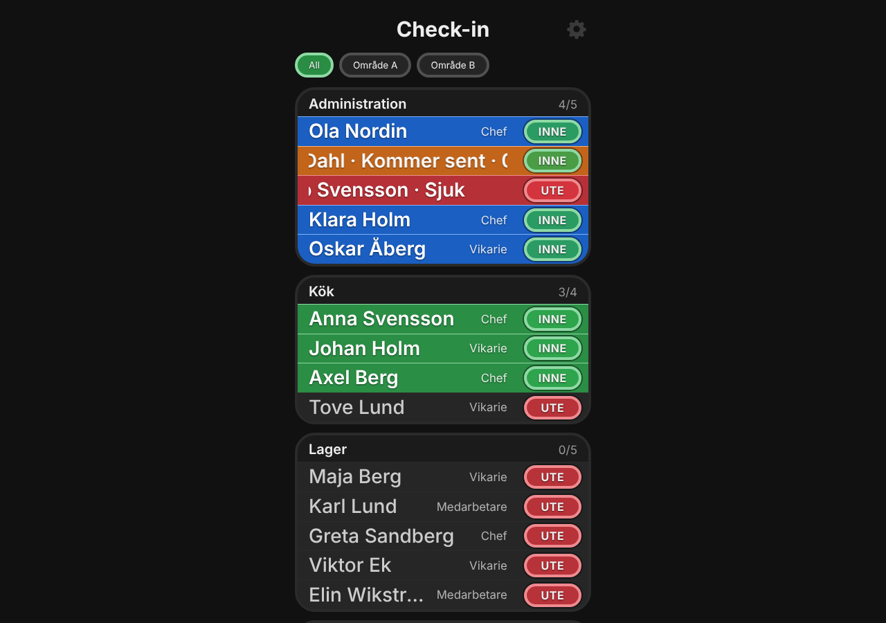
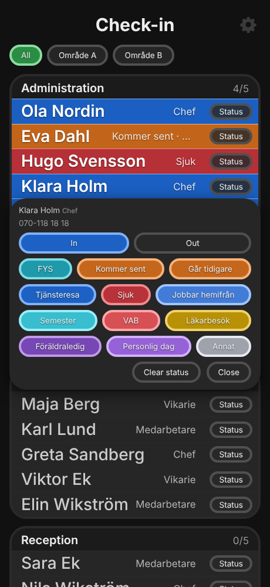

# Check-in board

A check-in board for any Linux computer (a small, cheap one is plenty) that **several screens show in step**: who is in, who is out and why, in real time. The people come from a CSV file, and each one is a row that is grey while they are out and coloured while they are in, in the colour of their department or building. A green **INNE** / red **UTE** button on the row checks them in and out, and a tap on the row opens a status menu (sick, late, on a trip, holiday ...) whose status the row then shows in the status' own colour.

**CheckinChicken** is Python 3 with no dependencies (it replaces the earlier Node.js version, which is not in this repository any more). Everything the page shows is a module, so the base (updates, reboot, the System controls) and the board are separate pieces you can switch on and off. The web service runs as an ordinary user, never as root ([Safety](#safety)).

<p align="center"> </p>

What you get:
- **A box per department with a row per person.** The whole row, edge to edge in its box, is grey while the person is out and turns the department's colour while they are in. The **INNE** (green) / **UTE** (red) button at its right checks the person in or out. A tap on the row opens the **status menu** in the middle of the screen: photo (tap it to choose a picture), name, department, building, role and phone at the top, a cross to close, and the statuses as same-size buttons, three in a row. A status turns the row the status' colour and the name and status scroll round like a carousel. Large text: 60 people fit a 1080p screen in two columns (portrait) or three (landscape) with Max columns set to 2 or 3.
- **Colours by department and/or building**, picked from the page's palette (automatic, or your own pick for each department / building).
- **Screens in step in real time.** The host (one Linux machine) keeps everything; every other screen is only a browser that opens the host's address, in kiosk mode if you like (`kiosk/kiosk-browser.sh`). A change on one screen is on the others within about a second.
- **A screen per building:** with several buildings a row of chips picks what a screen shows (kept in that browser; `?location=Område A` in the address sets it).
- **Quick to use:** the INNE / UTE button switches the moment it is tapped (it does not wait for the host's answer; a failed request puts it back), and with the [number pad](#number-pad) a person is checked in by typing their three-digit number.
- **Contacts:** import a CSV (a file or pasted text), **add a person by hand** (Settings > Contacts > People > Add person), export it again, switch people off, tap a person to edit their name, department, role, phone and building (or delete them). The status menu is editable too (names, colours, time / date / note, dots, counts as out, sticky). The board can show each person's role and building (pick which ones), and has an optional on-screen number pad / keyboard for times, dates and notes.
- **Screens with nothing installed:** a kiosk computer can boot over the network into a small Linux image that shows the board in Firefox, behind a whitelist of serial numbers / MAC addresses, with a menu, per-computer settings, an optional install to the local disk, and a loading screen with the chicken logo. Each screen keeps its **own layout and settings** on the host, so they are back after a reload or a reboot.
- **Text and sound:** the text of the board has its own **size** (0.5 to 2 times, with presets) and **colour** (automatic: black on light boxes, white on the original dark grey ones; or black, white, any palette colour), separate from Stretch / Scale / Fit (which grow the rows and the spacing, never the text; Fit makes the text smaller only when the page is too tall); **button sounds** (a small pop; copy more `.wav` / `.mp3` / `.ogg` files into `/opt/checkin-board/sounds`); the theme can follow **the time of day** at the time zone (light by day, dark at night) for a computer without a light / dark setting of its own.
- **Dates and notes:** a status can ask for a time, a date, or a date and a time, with a **calendar** (square buttons) next to the date field and a **Skip** button; the on-screen keyboard is laid out like the iPhone's Swedish one, with emoji and an even number pad, and a USB keyboard can be used at the same time. Pictures of people are chosen in Settings > Contacts only.
- **Swedish or English:** **Settings > Appearance > Language** switches the whole page (every screen follows); a new install is in Swedish. Dates are Swedish in both: `åååå-mm-dd`, 24-hour `tt:mm`, `24/12`, Swedish month and day names.
- **Update and reboot buttons** on the page and an optional **PIN** for them.

**Tested so far:** on a development machine only, not on a real host or kiosk screen, and **the network boot has never been run on real hardware**: unit tests (`sh tests/run.sh`) and the page driven in Chromium against a demo server (`sh tests/ui/run.sh`). See [docs/hardware-status.md](docs/hardware-status.md) for what has and has not been seen on real hardware.

## Install

### Step by step: a fresh Debian 13 ("trixie")

For a computer that will be the host (the one that keeps the board). Any small PC will do. Not yet verified on real hardware (see [docs/hardware-status.md](docs/hardware-status.md)).

1. **Install Debian 13.** Use the "netinst" image. In the installer choose *SSH server* and *standard system utilities*; you do not need a desktop on the host. Give the computer a fixed address (a reservation in the router is the easiest) so the screens always find it.
2. **Log in** (or `ssh` in) and become root: `su -` (or put `sudo` in front of each command below).
3. **Install what the add-on needs:**
   ```
   apt update
   apt install -y git python3 openssl avahi-daemon
   ```
   (`git` fetches the code and the updates, `openssl` makes the HTTPS certificate, `avahi-daemon` makes the `.local` name work.)
4. **Get the code:**
   ```
   git clone https://github.com/blaskkaffe/CheckinChicken.git
   cd CheckinChicken
   ```
5. **Install it.** The `--hostname` makes the board answer at `http://checkinchicken.local`; the `--pin` asks you for a PIN that guards update, reboot and import (leave it out for none):
   ```
   ./install.sh --hostname=checkinchicken --pin
   ```
   It makes a user `checkin` (no login, no shell) for the web service, copies the code to `/opt/checkin-board` (owned by root: the service can read it but not change it), keeps the people and settings in `/var/lib/checkin-board` (owned by `checkin`) and starts the `checkin-board` service, which also starts at every boot. The service is **not root**: see [Safety](#safety).
6. **Open the board** from any computer or phone on the same network: `http://checkinchicken.local` or `http://<the host's IP address>` (find it with `ip -4 addr`). The first time you open the `https://` address the browser warns about the certificate; that is expected (see [HTTPS](#https)).
7. **Add your people:** the cogwheel > **Contacts** > import your CSV (the format is [below](#the-csv)). Then pick colours, the time zone and the look under **Settings > Appearance** and **Settings > System**.
8. **Check that it runs:** `systemctl status checkin-board` shows `active (running)`; `journalctl -u checkin-board -n 50` shows the log. If the page does not open, a firewall on the host may block ports 80 / 443 (`ufw allow 80,443/tcp` if you use `ufw`).
9. **More screens:** just open the same address in a browser on any other computer or tablet. For a wall screen on a Debian computer: `apt install -y chromium xorg openbox`, copy the `kiosk/` folder to it and run `kiosk/kiosk-browser.sh <the host's address>` (details above under *Other screens*). Screens with no installation at all: [Screens that boot from the network](#screens-that-boot-from-the-network).
10. **Update later:** in the page (**Settings > System > Update now**) or by hand:
    ```
    cd ~/CheckinChicken && git pull && sudo ./install.sh
    ```

### The short version

On the host (any Debian-family Linux with `systemd`, such as Debian or Ubuntu):
```
git clone https://github.com/blaskkaffe/CheckinChicken.git
cd CheckinChicken
sudo ./install.sh
```
Then open **http://&lt;the host's name&gt;.local** or its IP address in a browser (`sudo ./install.sh --hostname=checkinchicken` names the computer so that it is **http://checkinchicken.local**, the address the kiosk screens use when they are not told another one; `.local` names need avahi-daemon on the host) on the same network, open **Settings** (the cogwheel) > **Contacts** and import your people.

Other screens only need a browser (or no setup at all: see [Screens that boot from the network](#screens-that-boot-from-the-network)): open the same address, or run `kiosk/kiosk-browser.sh <host>` (Chromium full screen; `kiosk/checkin-kiosk-autostart.desktop` starts it at every login, so a power cut is no problem). `./kiosk-browser.sh 192.168.1.20 "Område A"` pins that screen to one building.

### The CSV

```
name,department,role,phone,location,restrictToLocation,code
Anna Svensson,Kök,Kökschef,070-123 45 67,Område A,,127
Maja Berg,Servering,,,Område B,x,
```
`name` is required; a person without a `department` goes under "No department". **`location` is the building** (in Swedish, "Område"). `restrictToLocation` (`1`, `true`, `yes`, `ja` or `x`) shows the person only on a screen that has their own building picked, never under "All". `code` (optional) is a person's three-digit number for the [number pad](#number-pad); a number belongs to one person (the first one in the file keeps it) and a file without the column leaves the numbers as they are. Lines starting with `#` are ignored; comma, semicolon or tab work; Swedish headers (`namn`, `avdelning`, `telefon`) are understood. Importing again updates people in place and **never deletes** anyone (tick "Switch off people that are not in the file" to take others off the board); who is in is kept. From a shell: `python3 modules/contacts/contacts_web.py people.csv`.

### Number pad

Without touching the screen: **type a person's three-digit number** on any keyboard (or a USB number pad) while the board is showing, and their status menu opens. Then `1` checks them in, `0` checks them out, `#` switches in / out, and **two digits from 20 up** pick a status (the number is shown on each status button in the menu: 20 is the first one in Settings > Statuses, 21 the second ...). `*` or Backspace takes a digit back (and closes the menu when nothing is typed), Esc closes. `1271` is: person 127, in. A status that needs a time, a date or a note opens its own pop-up as when tapped. An unknown number says so for a moment and does nothing. Give people their numbers in the CSV (`code`) or by tapping a person in Settings > Contacts > People (Number); switch the feature off in Settings > Check-in board > Number pad. Digits typed in a field, or while Settings is open, go to that field.

### HTTPS

Some browsers refuse or keep upgrading plain `http://` pages, so the page is also served over HTTPS on port 443. A host on a home or office network can't get a certificate from a public authority, so the installer makes a self-signed one:

- The first time you open the `https://` address, the browser warns that the connection isn't private. Choose **Advanced** and **Proceed** (the wording varies); most browsers remember that choice for the address. (A kiosk screen is easier on plain `http://`.)
- The traffic is still encrypted; the warning only means no public authority vouches for the certificate.
- The certificate is valid for about 2 years (Apple devices won't accept longer). Running the installer renews it when it has less than 30 days left.

Options:
- `sudo ./install.sh 8080` puts the HTTP page on another port, if port 80 is taken.
- `sudo ./install.sh --allow-sleep` leaves the computer's sleep settings alone (by default the host is kept awake: a sleeping host does not answer the screens).
- `sudo ./install.sh --https-port=8443` puts the HTTPS page on another port, and `--no-https` turns it off.
- `sudo ./install.sh --user=NAME` runs the web service as another user than `checkin` (an existing one, or a new system user; never root). An update keeps the user.
- `sudo ./install.sh --pin` asks for a PIN (`--pin=1234` gives it on the command line, which shows in the shell history); `--no-pin` removes it. See [Safety](#safety).

### Update

The page can do it for you while the **Reboot and Update** module is on: **Settings > System** (the Updates row) checks GitHub for a newer version of the add-on and **Update now** fetches and installs it (the checkout you installed from must be a git clone of a GitHub address). By hand:
```
cd ~/CheckinChicken && git pull && sudo ./install.sh
```
Settings, people and who is in are kept.

### Safety

The web page runs on the host as an ordinary user (`checkin`), not as root; the few things that need more (opening port 80 / 443, rebooting, updating) are handed to systemd with narrow rules (below). There are no user accounts: **anybody who can reach the page on your network can use it**, so only put the host on a network you trust, and don't forward its ports from the internet. What the add-on does to limit the risk:

- **PIN (optional).** `sudo ./install.sh --pin` sets a PIN that the page asks for (once per page load) before **Update now**, **Reboot** and a **contacts import**. It is stored only as a salted hash, and five wrong tries lock those actions for a minute. The PIN can also be set, changed or removed in **Settings > Appearance > PIN** (changing or removing it asks for the old one; while no PIN is set anybody on your network can set one there, which is why `sudo ./install.sh --no-pin` stays as the way back). **Ask for the PIN to open Settings** (same box) locks Settings: the cogwheel asks for the PIN and every change needs it, while tapping people in and out keeps working. Use the `https://` address when you use a PIN: over plain `http://` the PIN travels unencrypted. Forgot it? `sudo ./install.sh --no-pin`. Without a PIN, anybody on your network can update or reboot the computer.
- **Other websites can't use it.** Every change (all `POST`s) must come from the page itself: a request from another site (a form or script on a web page you have open in your browser) is refused, and so is a request that reaches the host under a name that isn't the host's (the trick used to attack devices on a home network from a web page). The page answers to IP addresses, `.local`-style names and the host's own name; if your router gives it another domain name and the page says "Unknown host name", list that name in `/opt/checkin-board/allowed_hosts` (one per line). The page can't be shown inside another site's frame.
- **Update from a USB stick.** Put a folder called `update` on a USB stick (the add-on's files: a copy of the repository with `install.sh`, `base/` and `modules/`; `git clone` it or copy it) and plug the stick into the host. **Settings > System** then shows **Update from a USB stick**; **Install from USB** (it asks for the PIN when one is set, and for confirmation) copies the folder to `/opt/checkin-board/usb_src`, so the stick can be pulled out, and runs its `install.sh` as root. The settings and the people are kept. The version then reads "USB update" with the date of the files; **Update now** from GitHub still works. Only plug in sticks you trust: what is in the folder runs as root. Tested with a folder on a disk, not with a real stick.
- **Update now is limited to GitHub.** It only pulls from the git address the checkout had when the add-on was installed (it must be a GitHub address, and a changed one is refused), fetches from exactly that address, and only fast-forwards, so it can't pull in changes that don't continue your copy.
- **The web service is not root and is fenced in.** It runs as the user `checkin` with no login. The one privilege it keeps is opening port 80 / 443 (`CAP_NET_BIND_SERVICE`). The code in `/opt/checkin-board` (and the PIN hash, the update source and the version, which only the installer writes) is root-owned: the service can read it, not change it; it can write only in `/var/lib/checkin-board` and its own `/run/checkin-board`. Systemd also gives it no new privileges, a read-only file system outside those folders, no `/home`, no private `/tmp` sharing, no kernel-module, cgroup or kernel-setting changes. **Reboot** and **Update** go through three root-owned systemd units (`checkin-board-reboot`, `checkin-board-update@git`, `checkin-board-update@usb`) that a polkit rule lets the service *start* and nothing else; the updater (`modules/rebootupdate/update-run.sh`) takes the checkout, its GitHub address and the ports from files only root can write, never from the page. If polkit (0.106 or newer) is missing the installer says so and the page's Reboot / Update buttons cannot work: run `sudo ./install.sh` yourself and `sudo reboot`. Details and what is verified on real hardware: [docs/web.md](docs/web.md), [docs/hardware-status.md](docs/hardware-status.md).
- **The network boot server** (if you use it) lets only whitelisted computers boot and fetch the image; a copied serial number / MAC address gets past that, and any computer on the network is offered the small iPXE program (details in [docs/pxe.md](docs/pxe.md)).
- **Not covered:** anybody who can open the page can also tap people in and out and change the board: there is no per-person login (the PIN only guards the actions above); someone who is already logged in on the host (or can run code on it) can do more than this add-on ever could, and a compromised web service can still change the people and the board (it owns `/var/lib/checkin-board`), start an update of the recorded checkout and reboot the computer, but not read other users' files or change the program. The update runs the checkout's own `install.sh` as root, so keep that checkout owned by an administrator.

### Modules

Everything the page shows is a module, one folder in `modules/`. **Settings > System > Modules** switches them and sets their order:

| Module | What it does | Default |
|---|---|---|
| Check-in board | The board: a box per department, a row per person, statuses, colours | on |
| Contacts | The people: CSV import and export | on |
| System | Versions, the time zone, PIN, Modules, updates, reboot, a link to the project (always on) | on |
| Background image | A picture of your own as the page's background: choose it in Settings > Background image (big pictures are shrunk in the browser first), fit and darken it | **off** |
| Reboot and Update | Update the add-on from GitHub, reboot the host | on |
| Snow background | A snowstorm in soft fog behind everything (3D, WebGL), with a day and night that follow the time zone | **off** |

Developers: [docs/modules.md](docs/modules.md) (how to add or remove a module), [docs/checkin.md](docs/checkin.md) (the board and the contacts), [docs/web.md](docs/web.md), [docs/pxe.md](docs/pxe.md) (network boot), [docs/offline.md](docs/offline.md) (offline install), [docs/hardware-status.md](docs/hardware-status.md). `CLAUDE.md` is the short guide for working on the code.

### Screens that boot from the network

Opt-in, and separate from `install.sh`. Full description: [docs/pxe.md](docs/pxe.md). **Not tested on real hardware yet.**

```
sudo ./pxe/build-image.sh        # once, on a Debian / Ubuntu computer with internet: builds the image (a few minutes, 500-700 MB)
sudo ./pxe/install-pxe.sh        # on the host: proxy DHCP + TFTP + the boot server (your router keeps handing out addresses)
```
Then set a screen's BIOS / UEFI to boot from the network (PXE); nothing is installed on it (it needs about 2 GB of memory).

- **Whitelist.** Only approved computers boot. A new one shows its serial number and MAC address on its screen and is listed as pending: `checkin-pxe pending`, then `checkin-pxe allow <serial or MAC>` (or `block`). `checkin-pxe mode open` turns the check off.
- **Menu or straight in.** An approved computer that is not set to anything gets a menu: the available images, install an image on the local disk (when the image allows it), a Linux shell, the iPXE shell, boot the local disk. `checkin-pxe assign <serial> kiosk --location "Område A"` sets one computer's boot settings (image, buildings, board address, kernel arguments): it skips the menu and boots at once, and pressing **I** while it boots starts the install wizard for the local disk.
- **Layout stays.** The screen opens `<host>/?screen=<its serial number>`; the host keeps that screen's columns, theme, tile places and building choice apart from the other screens.
- **Limits.** The whitelist checks what the computer says its serial number and MAC address are, so it keeps strangers away but is not strong authentication; use it on a network you trust. See [Safety](#safety) and [docs/pxe.md](docs/pxe.md).

### Offline install

For a computer without internet: on an online computer with the **same distribution, release and CPU type** run `sudo ./offline/prepare-offline.sh --with-image`. It collects the packages with everything they depend on (Python 3, openssl, git, **Firefox ESR, Chromium, mpv**, dnsmasq-base, ipxe ...), a copy of this repository and the network boot image into `offline/bundle/`. Copy that folder over and run `sudo ./install-offline.sh --board --pxe` in it. Details, the package list and the limits: [docs/offline.md](docs/offline.md).

### Restarts after crashes

A kiosk browser (Chromium on a host screen, Firefox or Chromium on a network-booted one) is started again two seconds after it crashes; the web service and the screen's X session restart by themselves; and the computer reboots itself after a kernel panic (10 s) or when systemd hangs (watchdog, where the hardware has one; the network boot image adds a software watchdog). `uninstall.sh` removes the computer-level settings.

### Uninstall

`sudo /opt/checkin-board/uninstall.sh` removes the services, the user it made, `/opt/checkin-board` and `/var/lib/checkin-board`, **people and who is in included**. Export the contacts first (Settings > Contacts > Download). The network boot server is removed separately: `sudo ./pxe/install-pxe.sh --remove`.

## Requirements

- A computer for the host: any Linux machine with `systemd` (a small, cheap one is plenty; Debian and Ubuntu are the families it is written for), Python 3 and `git`. No Python packages and no internet are needed at run time (the update check and **Update now** need GitHub).
- A browser on every screen; the kiosk script assumes Chromium (`chromium-browser` or `chromium`); the network-booted image brings its own Firefox. The network boot server needs `apt` (it installs `dnsmasq-base` and `ipxe`) and an image built with `pxe/build-image.sh` (needs `debootstrap`, internet and a few GB of disk).

## Web page

The main page is the board. The cogwheel opens **Settings**; rows with an **Edit** button open a pop-up menu and show what is chosen in it as their subtitle:

- **Check-in board:** what to group by and what to colour by (department or building), a colour for every department and building (Automatic or your pick), **All out** (the start of the day) and **All in**.
- **Appearance:** **Theme** (dark, light, like the device, or by the time of day at the time zone); **Layout** (hide the top bar, **hide the top bar completely** or just **the cogwheel** (Settings is then at `<address>/settings`, which asks for the PIN when one is set), max columns for the dashboard and for Settings, stretch boxes, scale content, fit to screen); **Rearrange the main screen** (drag the tiles; their order is kept on the host, so every screen follows); **No scrolling**; **Text** (size 0.5 to 2 times, colour); **Button sounds** (off, or a sound file and a volume); **Colours** (the colour palette, Global main colour, the check-in board's colour); **Background** (a picture, a snowstorm, each with its own settings). With more than one column a department with more people than fit under each other in the screen height is split into near-equal parts in the next columns, "Kök (1/2)", "Kök (2/2)".
- **Contacts:** how many people, import (a file or pasted text), Export.
- **System:** versions and the address, GitHub, the **PIN** and **Ask for the PIN to open Settings** (the board itself keeps working without it), the **time zone**, **Modules**, Updates, Update from a USB stick, Reboot, and **Backup**: Download saves the people, statuses, who is in, colours, screen settings and profile photos as one zip (PINs and the HTTPS key are left out); Choose backup + Restore puts them back and replaces what is on the computer (verified only in tests, not on a real computer).

The page works on a phone as well as a wall display: the dashboard is one column by default and uses as many columns as you allow in Appearance, each department box being a tile of its own.

## Checking it works

- The page shows red warning boxes at the top when something is wrong (a module that could not load).
- If the page doesn't open at all, the host may have no network connection. If it is unreachable now and then, or slow to open the first time: try the host's IP address instead of the `.local` name (looking up `.local` names can take a few seconds on some phones and PCs);
- **The screens lose contact and it comes back when somebody uses the host** (clicks in its browser, moves the mouse): the host was **asleep**. A desktop Debian suspends after about 20 minutes without input, and nobody touches a computer that only serves a board. `install.sh` now stops it (it masks the sleep targets and tells logind to ignore idleness, the lid and the keys; `--allow-sleep` leaves sleep alone, `uninstall.sh` puts it back), and the web service logs `the computer was ASLEEP` when it notices. Also look in the BIOS / UEFI for sleep or power-saving settings of the network card. By hand, without installing: `sudo systemctl mask sleep.target suspend.target hibernate.target hybrid-sleep.target`.
- **Screens lose contact and the host does not answer ping either** (the page itself can not make the computer stop answering ping: the host's own network is dropping out): run `sudo /opt/checkin-board/diagnose-network.sh` on the host and `/opt/checkin-board/diagnose-network.sh <the host's address>` on a screen while it is not working. The web service also logs a line whenever the host's network changes (a link going down, an address lost or changed, the router not answering): `journalctl -u checkin-board | grep network:`. Common causes on a cable: the network card or its driver (`journalctl -k | grep -iE 'NETDEV WATCHDOG|link is down|r8169|e1000'`; a Realtek card needs `apt install firmware-realtek`; an Intel card that hangs often runs fine after `ethtool -K <eth> tso off gso off gro off`), a speed / duplex mismatch with a cheap switch (the watch logs `negotiated ... Mb/s ...`), two computers with the same address (the script checks with `arping`), an address from DHCP that changes (give the host a fixed address or a reservation in the router), a `.local` name that does not resolve (use the IP address), a flaky cable, switch port or network card.
- `journalctl -u checkin-board -n 50` shows whether the page service restarted or logged an error. It restarts itself within seconds if it ever stops answering.
- `curl http://localhost/api` shows what every screen is told (the `checkin` key is the whole board).

## Credits

The board, the statuses and the CSV format come from the first, Node.js version of CheckinChicken (a check-in board for the same kind of office). The module base and the update / reboot controls come from an earlier add-on of the same author.
